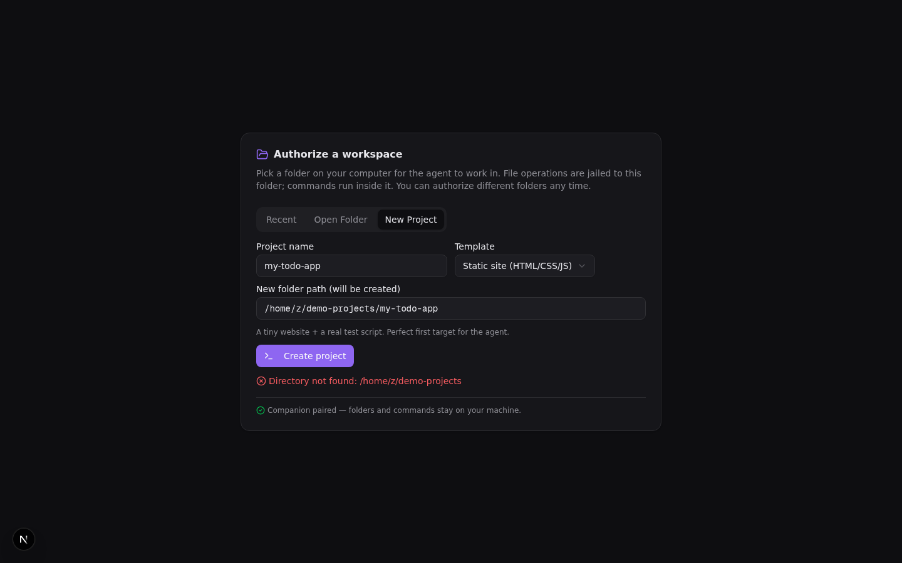
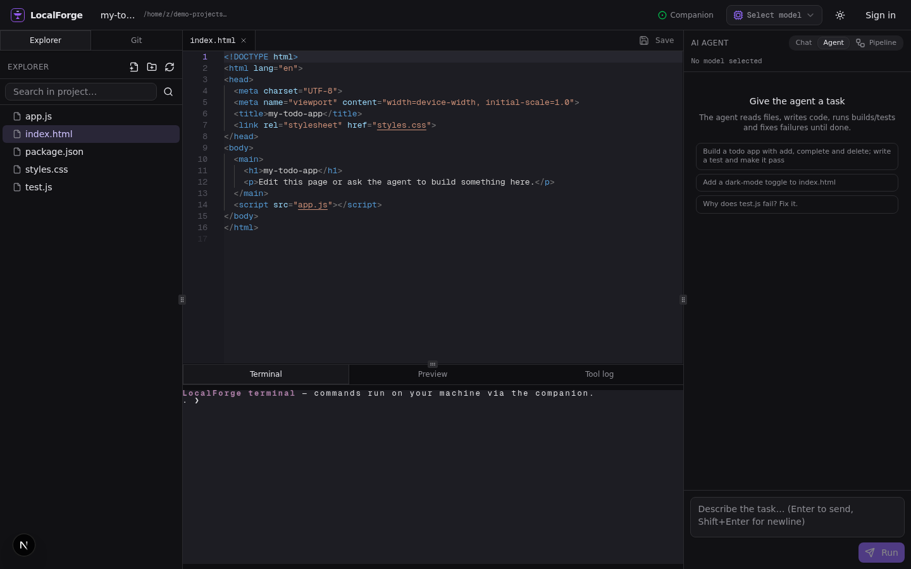
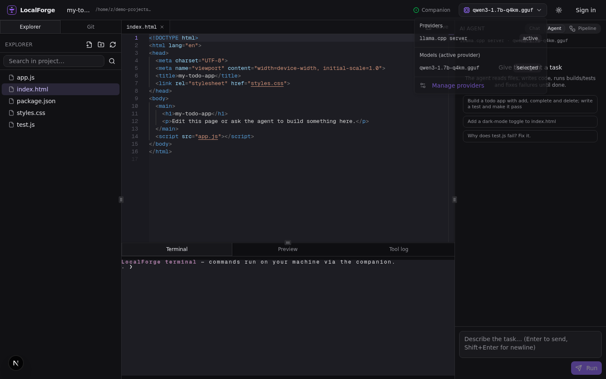
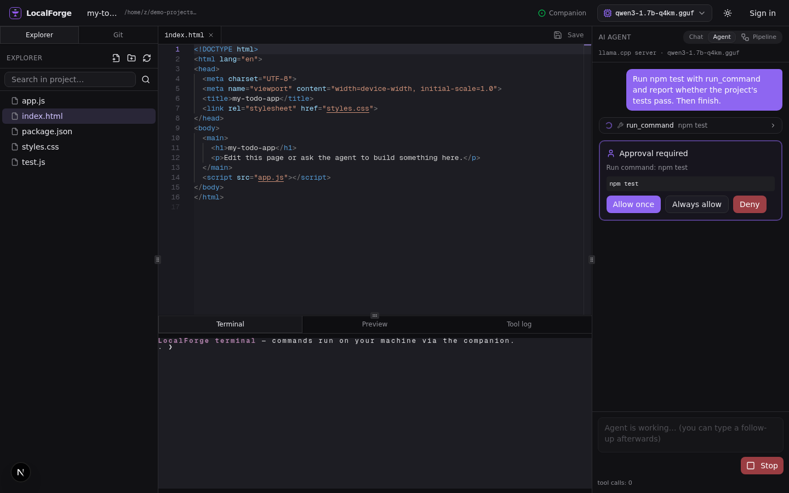
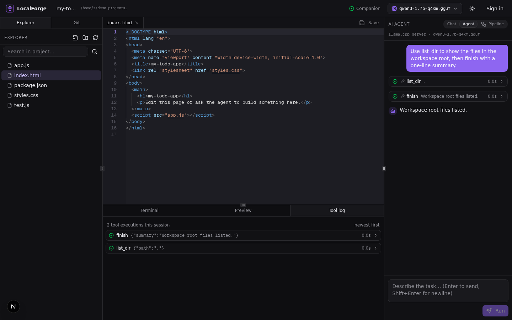

# LocalForge IDE

**Your models. Your machines. Your workspace.**

A self-hostable AI coding IDE with real project files, terminals, local-model connections, coding agents, and a multi-machine control center.

**[Get started](#quick-start) · [Windows Companion](https://github.com/kayock/Kayocks-Local-Forge/releases/tag/v0.5.0-rc4) · [Features](#what-you-can-do) · [Screenshots](#screenshots) · [Documentation](#documentation)**

> **Current release: v0.5.0 RC4 (prerelease, November 2026).** This is an actively developed prototype, **not a stable general-availability release**. The packaged Windows Companion passed automated GitHub-hosted Windows installation, pairing, and real terminal tests. Physical desktop installer acceptance and complete multi-machine end-to-end reliability testing are still in progress. In a real Station/Windows/Portable QR-code project run, LocalForge successfully connected models across machines, handed off agent work, and created files, although the test stage failed and the generated application displayed a blank page. See the [release notes](docs/releases/v0.5.0-rc4.md) and [verification details](docs/VERIFICATION.md).

## Quick start

You can self-host the IDE and Companion from this repository, or use a deployed browser IDE with a separately installed Companion. **Opening the website does not install software on your computer.**

### Option A — Install the IDE and prepare your Companion from source

**Requirements:** Git, Node.js 20 or newer, npm, and a computer running Windows 10/11 x64, Linux, or macOS. The Windows installer is available for x64; Linux/macOS use the Companion source path. macOS has not completed hardware acceptance testing.

~~~bash
git clone https://github.com/kayock/Kayocks-Local-Forge.git
cd Kayocks-Local-Forge
npm run setup
~~~

The setup command prepares the IDE dependencies and Companion:

| Platform | What setup does |
| --- | --- |
| **Windows 10/11 x64** | Offers the published GitHub Releases Companion installer, downloads it, checks its SHA-256 digest, and launches the standard Windows installer after confirmation. |
| **Linux** | Installs the Companion's dependencies from this checkout. No system-wide package or background service is created. |
| **macOS** | Uses the same source-based Companion path; desktop compatibility is not yet fully verified. |

The setup script **does not silently install an application**, overwrite an existing `.env`, reset your database, replace an existing Windows Companion without `--upgrade`, change your pairing/workspaces, or enable an automatic-start service. An existing source Companion dependency installation is left in place by default.

**Start the Companion.** On Windows, open **LocalForge Companion** from the Start Menu and find its pairing code in the tray app. On Linux or macOS, run in a separate terminal:

~~~bash
npm run companion:start
~~~

**Start the IDE.** For a *new* self-hosted installation, review `.env` (created by setup only if absent), then initialize the new database:

~~~bash
npx prisma db push
~~~

Start the development IDE:

| Linux / macOS | Windows |
| --- | --- |
| `npm run dev` | `npx next dev -p 3000` |

> Windows uses `npx next dev -p 3000` here because the current `npm run dev` script uses Unix shell features. This does not affect the Windows Companion installer.

Visit **http://localhost:3000/#/ide**, enter the eight-character Companion pairing code, authorize a project folder, then select an already-running model server in Settings.

**Already installed?** Run `npm run setup` again to preserve working installations. Use `npm run setup -- --upgrade` only when you intentionally want the setup script to update the Companion. `npm run setup -- --companion-only` skips IDE dependency preparation.

### Option B — Use the browser IDE with the Windows Companion

If you already have access to a deployed LocalForge IDE, you **do not need to clone this repository** just to use its browser interface. Install and start the Windows Companion on the machine whose files and models you want to use, then pair it from **Launch IDE**.

**[Download LocalForge Companion v0.5.0 RC4 for Windows](https://github.com/kayock/Kayocks-Local-Forge/releases/download/v0.5.0-rc4/LocalForge-Companion-Setup-0.5.0.exe)** · [SHA-256 checksums](https://github.com/kayock/Kayocks-Local-Forge/releases/download/v0.5.0-rc4/SHA256SUMS.txt) · [Windows installation guide](docs/WINDOWS_INSTALL.md)

This is an **unsigned** installer. Windows may show an unknown-publisher SmartScreen warning. Verify the published checksum before running the file; do not disable antivirus protections. The installer is for the **Companion**, not a bundled Windows desktop IDE. No model weights or inference servers are included.

### From pairing to your first task

1. Start a Companion and copy its pairing code (from the Windows tray or Linux/macOS terminal).
2. Open **Launch IDE** and pair the browser with that Companion.
3. Open or create a project and authorize its workspace folder.
4. Start your own Ollama, LM Studio, llama.cpp, Lemonade, or OpenAI-compatible server; in **Settings → Discover**, select the endpoint and model.
5. Give the agent a coding task. Review its file operations, commands, test results, and completion evidence in the IDE.

## What you can do

| Area | Capability |
| --- | --- |
| **Real coding workspace** | Monaco editor, file explorer, multi-tab editing, terminal, preview, project templates, Git operations, and tool history. |
| **Coding agents** | Plan/Act workflows; file reads/writes, searches, shell tools, builds, tests, checkpoints, review and rework. Models vary in their ability to use tools reliably. |
| **Bring your own models** | Connect to locally running Ollama, LM Studio, llama.cpp, Lemonade, and compatible endpoints; choose models and settings without bundling model weights. |
| **Multi-agent collaboration** | Planner, coder, tester, and reviewer handoffs, with model and workspace choices controlled by the user. |
| **Fleet control** | Discover and connect Companions, view machines, select workers, and inspect Live Runs and coordination state. A real Station/Windows/Portable collaboration demonstrated orchestration, model connections, agent handoffs and file creation; broader production reliability remains unverified. |
| **Persistent project context** | Workspace indexing, task sessions, recovery checkpoints, and project memory are included in the current development code. |
| **Visible execution** | Tools and commands are displayed with results; authorization and execution policy stay under user control. |

LocalForge is designed around **explicit participation**: connecting a machine does not by itself authorize it to run a task. A controller coordinates; workers participate according to user settings. It does **not** need to load or download a model just to inventory available endpoints.

## Screenshots

These screenshots come from the repository's existing validation evidence. Some screens may differ in the current release candidate.

| Editor and project | Model configuration |
| --- | --- |
|  |  |

| Agent execution | Tool activity |
| --- | --- |
|  |  |

The Fleet Map, Control Center, and Live Runs screens are part of the current development interface; an updated screenshot set for those newer views has not yet been published in this repository.

## How it works

~~~text
Browser IDE (Next.js)
       |
       | direct / explicitly configured Companion connection
       v
LocalForge Companion on your computer
       |-- authorized workspace files and Git
       |-- terminal, commands, builds and tests
       |-- local model endpoints and streaming
       |
       +-- optional explicitly connected LAN Companions
               |-- their own files, terminals and model endpoints

Optional hosted services: account/project metadata (not your source files).
~~~

The **IDE** is the web interface. The **Companion** is the process that can access a machine's authorized folders, terminal and model servers. They are separate because a browser alone cannot safely perform local filesystem and shell work.

By default, local file access and model requests are handled through the Companion. A hosted account backend stores metadata, not repository contents or prompts. If you deliberately configure an **external inference provider**, requests sent to that provider are subject to its own handling and privacy policies. See [architecture](docs/ARCHITECTURE.md), [API contracts](docs/API_CONTRACTS.md), and [deployment](docs/DEPLOYMENT.md).

## Release and verification status

**Latest published Windows package:** [v0.5.0 RC4](https://github.com/kayock/Kayocks-Local-Forge/releases/tag/v0.5.0-rc4) — a **prerelease**, not a stable v0.5.0 launch.

| Area | Evidence / current limit |
| --- | --- |
| Core editor, project tooling, browser agent flow | Implemented and covered by documented build, browser, protocol, and integration checks. |
| Windows Companion installer and terminal | Automated Windows-runner installation, pairing, genuine ConPTY commands, interrupt recovery, and uninstall passed for the RC4 artifact. |
| Local models and agent workflows | Protocol and targeted live-model tests exist; behavior varies by model, and an end-to-end run with your own server is recommended. |
| Multi-machine discovery and coordinated runs | **Demonstrated on a real three-machine LAN run:** Station orchestration, Windows and Portable model connectivity, agent handoff, and file creation worked. The QR-code application itself failed testing and displayed a blank page; comprehensive, repeatable end-to-end validation remains outstanding. |
| Linux and macOS | Linux source Companion supported; no Linux desktop installer ships in RC4. macOS source compatibility is not equivalent to tested, signed native packaging. |
| Hosted billing and teams | Prototype scaffolding only; live payments are disabled. |

Some older feature-matrix pages describe earlier milestones. For **RC4-specific packaging and test claims**, use the [release notes](docs/releases/v0.5.0-rc4.md) and [Windows guide](docs/WINDOWS_INSTALL.md). Do not assume a new source commit updates an installer that users have already downloaded.

## Developers and testers

From a checked-out repository with dependencies installed:

~~~bash
npm run test:setup        # setup/release-selection tests
npm run test:companion    # Companion integration suite
npm run test:protocol     # IDE protocol checks (requires Bun)
npm run build             # production IDE build
~~~

The full local-model E2E test requires a **running, reachable model server**. See [verification instructions](docs/VERIFICATION.md) for the exact procedure and the limits of automated results. The Windows installer is built and exercised by [Windows installer CI](https://github.com/kayock/Kayocks-Local-Forge/actions/workflows/windows-installer.yml); it is not regenerated merely by editing the source.

**Development branch:** [`v0.5-dev`](https://github.com/kayock/Kayocks-Local-Forge/tree/v0.5-dev) · **Default branch:** [`main`](https://github.com/kayock/Kayocks-Local-Forge)

## Documentation

| Guide | Purpose |
| --- | --- |
| [Windows installation](docs/WINDOWS_INSTALL.md) | Companion download, tray, pairing and troubleshooting |
| [Deployment and operations](docs/DEPLOYMENT.md) | Self-hosting, hosting architecture, configuration |
| [Architecture](docs/ARCHITECTURE.md) | Main components, agent and Companion design |
| [API contracts](docs/API_CONTRACTS.md) | IDE ↔ Companion interfaces |
| [Feature matrix](docs/FEATURE_MATRIX.md) | Detailed feature coverage, including prior milestone statuses |
| [Verification](docs/VERIFICATION.md) | Automated/manual test procedures and evidence |
| [Limitations and next steps](docs/LIMITATIONS_AND_NEXT_STEPS.md) | Known gaps and roadmap, including earlier milestone notes |
| [RC4 release notes](docs/releases/v0.5.0-rc4.md) | Verified installer, provenance, and outstanding acceptance tests |
| [Database schema](docs/DATABASE_SCHEMA.md) | Hosted metadata model |
| [Third-party licenses](docs/LICENSES.md) | Dependency/license information |

## Troubleshooting and feedback

**Download link fails?** Use the [GitHub release assets](https://github.com/kayock/Kayocks-Local-Forge/releases/tag/v0.5.0-rc4) directly. The current pairing screen uses a same-origin download endpoint that selects published Windows installers.

**Companion not reachable?** Confirm the Companion is running; its default address is `http://127.0.0.1:7337` for local pairing. Check [Windows troubleshooting](docs/WINDOWS_INSTALL.md) for browser permission and tray details.

**No models found?** Start your inference server first, verify its endpoint is reachable from the Companion machine, then run **Discover**. LocalForge does not install or launch your models automatically.

**Working from multiple computers?** Install a Companion on each machine you intend to expose for local file/terminal access, pair it, and explicitly configure its participation. Connecting alone is not permission to dispatch work.

Bug reports, test results, and pull requests are welcome through [GitHub Issues](https://github.com/kayock/Kayocks-Local-Forge/issues). Include OS, Companion version, exact steps and expected/actual results; **remove passwords, tokens and private project data** from logs.

## License

LocalForge is distributed under the **MIT License**; see the [license text](installer/windows/LICENSE.txt) and [third-party licenses](docs/LICENSES.md) for bundled dependencies.
