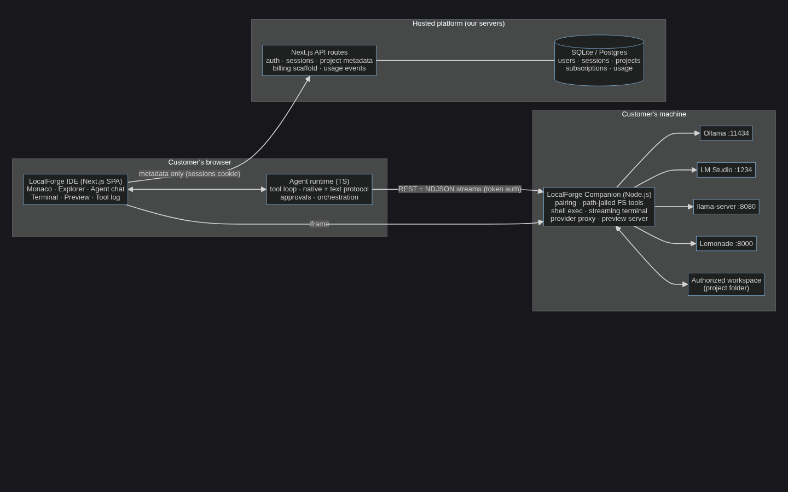
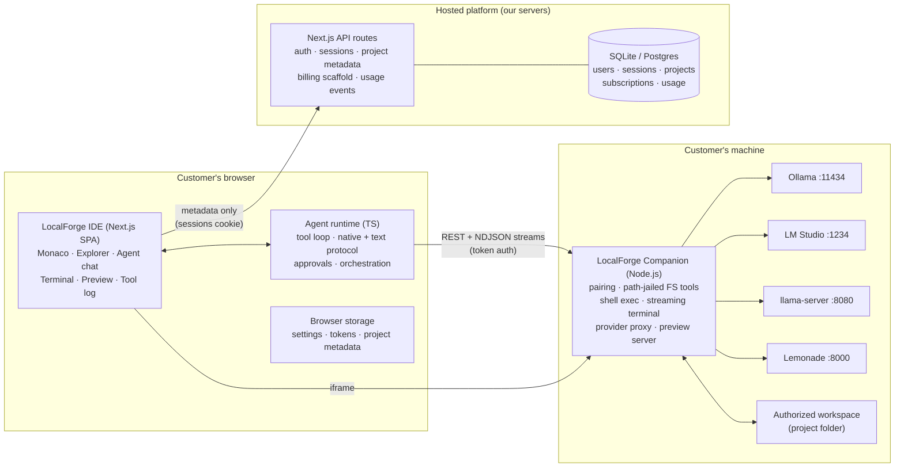

# LocalForge IDE — Architecture

## 1. Design goals

1. **Local by default.** Source code and model traffic flow
   `browser → companion → local model server`. The hosted backend never sees
   prompts or files in this build.
2. **Beginner-friendly.** One install command + one pairing code; no terminal
   knowledge needed for normal use.
3. **Real execution.** Agents get actual tools (files, shell, search) with
   results fed back into the model loop until tasks complete.
4. **Modular commercial foundation.** Accounts/billing/teams are separated from
   the IDE and from local execution; inference costs are the customer's own
   hardware, so the platform never charges per inference token.

## 2. System diagram





Key property: the only line that crosses the network boundary between the
customer and the hosted platform is the **metadata** line. Everything else —
every prompt, every byte of source code, every build/test run — stays between
the browser and the companion on the customer's own machine/LAN.

## 3. Components

### 3.1 Web IDE (`src/`)

- **Single-route SPA** (`src/app/page.tsx`) with hash views: `#/` landing,
  `#/ide`, `#/dashboard`, `#/settings`, `#/auth`. Deployment-friendly: one
  externally visible route; views are client-side.
- **IDE shell** (`src/components/ide/`): resizable dock layout
  (`react-resizable-panels`): left = explorer/git, center = Monaco + bottom dock
  (terminal / preview / tool log), right = agent panel.
- **Monaco** is self-hosted from `public/monaco/vs` (AMD loader, no CDN).
- **State** (`src/lib/store/`): zustand + localStorage persistence
  (`settings`, `workspace`, `agent`, `router`, `auth`).
- **Companion client** (`src/lib/companion/client.ts`): typed REST + NDJSON
  streaming client with two transport modes:
  - `direct` — `http://127.0.0.1:7337` (production; browser → user's machine),
  - `gateway` — same-origin path + `XTransformPort` query (hosted preview /
    reverse-proxy deployments; identical contract).
- **Agent runtime** (`src/lib/agent/`): pure TypeScript, zero DOM dependencies,
  shared verbatim between the browser IDE and the Node E2E script.
- **Forge Control** (Phase Two): `src/components/forge/ForgeView.tsx` with
  three surfaces — **Projects Hub** (create/open/switch/resume projects bound
  to host + workspace + models + contract + run history), **Fleet Map**
  (machine network with honest states: unreachable → discovered → paired →
  inference-ready; static SVG, on-demand refresh), **Live Runs** (persisted
  operation timelines with failure inspection and steer/stop/continue
  controls). Reachable from the TopBar (`#/forge`).

### 3.2 Companion (`companion/`)

A dependency-light Node.js service (runtime dependency: `ws` only, and even
that is optional for the HTTP-only path). Responsibilities:

| Module | Role |
| --- | --- |
| `src/config.js` | State (`~/.localforge-companion/state.json`), pairing code, token store, workspace registry, JSONL local logs |
| `src/auth.js` | Pairing-code → bearer token flow (rate limited, timing-safe compare) |
| `src/fsapi.js` | Tree/read/write/mkdir/delete/rename/search with **path jail** (logical + realpath check) and binary/large-file guards |
| `src/exec.js` | Shell execution: streaming NDJSON terminal, batch exec, cwd tracking, interrupts (process-group kill), timeouts, **hard-deny** and **needs-confirm** command screening |
| `src/providers.js` | Discovery probe (Ollama / LM Studio / llama.cpp / Lemonade), normalized streaming chat proxy, model load/unload, native-tool probe, connection test |
| `src/preview.js` | Static preview server + dev-server reverse proxy (frame headers stripped) |
| `src/server.js` | HTTP routing, CORS (+ Private Network Access headers), SSE events, optional WebSocket terminal channel |

Security model (v1): loopback bind by default; pairing code shown only in the
local console; bearer tokens persisted per device; all `/api/*` routes require
the token; every FS path is jailed to the authorized workspace; dangerous
shell commands require an explicit `confirm` flag that only the user-facing UI
supplies after an approval interaction. Roadmap: per-device certificates,
in-companion TLS, process-level sandboxing (see LIMITATIONS).

### 3.3 Hosted backend (`src/app/api/`)

- `auth/*` — scrypt password hashing (node:crypto), opaque session tokens
  (sha256-hashed in DB), httpOnly cookie sessions.
- `projects/*` — project **metadata** CRUD (name, local path label, companion
  label). No file contents, by design.
- `billing/*` — tier catalog, status, Stripe Checkout + webhook scaffold
  (signature-verified) behind `SUBSCRIPTIONS_ENABLED` — inert in the prototype.
- `usage` — hosted-service usage events (e.g. `agent_run` counts). Never
  inference tokens: inference happens on customer hardware.

### 3.4 Agent runtime (`src/lib/agent/`)

```
AgentRunner (runner.ts)
 ├─ builds messages [system, context, task, …history]
 ├─ tool protocol mode (settings-persisted, per model profile):
 │     'native' — genuine function calling, never nudged/injected
 │     'text'   — JSON-per-turn text protocol (protocol.ts)
 │     'auto'   — starts native; falls back to text only on server rejection,
 │               recording the reason (mode_change) and remembering the choice
 ├─ normalizes every call: tool-name aliases (bash→run_command, …) and
 │   argument aliases (old_content→find, new_content→replace, cmd→command, …)
 │   before validation; validation errors name the exact missing parameter,
 │   what was received and the accepted aliases (tools.ts)
 ├─ executes tools (tools.ts) through the companion:
 │   list_dir read_file write_file edit_file create_dir delete_path
 │   search_project run_command launch_app process_status stop_process
 │   install_dependencies run_tests run_build finish
 ├─ repetition guard: identical successful calls ≥2× (reads ≥3×) are not
 │   re-executed; the model receives the previous result plus a strategy hint
 ├─ approval gate per execution policy (auto / confirm-commands / confirm-all)
 └─ feeds tool results back as messages; loops until finish/limits; on the
    configurable turn limit it pauses (hitTurnLimit) and preserves the full
    message history so the IDE "Continue task" button can resume losslessly

PipelineRunner (orchestrator.ts)
 └─ planner → coder → tester → reviewer stages, each an AgentRunner with
    its own prompt, tool subset and optional model override; reviewer can
    hand work back to coder (rework pass). Tool subset now includes the
    detached-process tools for coder/tester.
```

Tool protocol details:

- **Native** (`native`/`auto`): tools sent in OpenAI `tools` format; Ollama/
  llama.cpp/LM Studio tool-call deltas are normalized by the companion into
  unified `{t:'tool_call', name, args}` events. The text-protocol helper
  (nudges) is NEVER injected in native mode — real-world testing showed it
  degrades capable models like Qwen3-Coder-30B.
- **Text fallback** (`text`/auto-after-fallback): the model replies with
  exactly one JSON object per turn — `{"tool": "...", "args": {...}}` — the
  runner parses (fence-tolerant, trailing-comma/single-quote/unquoted-key
  tolerant, balanced-brace extraction, double-encoded args recovery),
  executes, and returns `[TOOL RESULT]` user messages. Models that answer in
  prose get one protocol nudge, then their text is accepted as the final
  answer.
- **Detached processes**: `launch_app` starts GUI/desktop apps and servers
  through the companion's `/api/ws/:id/proc/start` (immediate return with
  id+pid); `process_status` / `stop_process` report the real lifecycle
  (running/exited-with-code/stopped/failed) from the companion process
  manager (`companion/src/procs.js`, whole-tree kill via taskkill on Windows,
  process groups on POSIX).
- **Test/build discovery**: `run_tests`/`run_build` detect the project type —
  package.json scripts, Cargo.toml, go.mod, Makefile, and Python projects
  (pytest with unittest fallback) — and never assume package.json.

## 4. Data flows

**Agent task (browser):**
1. UI → `AgentRunner.run()` with task + workspace context (shallow tree,
   package.json summary, OS).
2. Each turn: `POST /api/chat` (companion) → provider (local model) →
   normalized stream → text deltas rendered live.
3. Tool calls → approval gate (policy) → companion REST (`/api/ws/:id/...`) →
   result back into the loop.
4. Every tool execution is recorded in the store (chat card + tool log panel).

**Terminal:** the panel implements local line editing (echo, history, Ctrl+C)
and streams each command via `POST /api/ws/:id/term` (NDJSON), tracking cwd
via the companion's exit marker; Ctrl+C signals the running process group.

**Preview:** `preview-token` mints a short-lived token; the iframe loads
`/preview/:wsId/:ptok/` (static) or `/p/:ptok/:port/` (dev-server proxy) from
the companion.

## 5. Extension points (Phase 3+)

- More agent graphs: `PipelineRunner` stages are plain data
  (`STAGE_TOOLS` + prompt). Parallel fan-out = run multiple `AgentRunner`s and
  merge; no core changes.
- Model routing: per-stage `stageModels` already supported end-to-end
  (runtime + orchestrator); richer capability routing plugs into
  `probeTools` + per-model metadata.
- Remote agents: the companion API is the agent's execution backend; a future
  "agent host" service can implement the same contract headlessly.
- Tool-capability discovery: `probeTools` result is cached per model in
  settings; extend to parameter-schema validation before first call.
