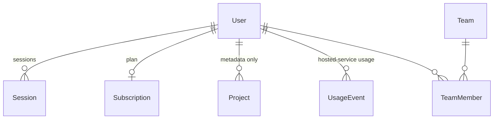

# Database Schema (Hosted Backend)

Prisma + SQLite (`prisma/db/custom.db`) in the prototype; the schema maps 1:1
to PostgreSQL for production (change `datasource db.provider`).

**Design rule:** the hosted backend stores *account, billing and metadata*
data only. Source code, prompts, transcripts and inference telemetry live on
the customer's machine. `UsageEvent` counts hosted-service interactions, never
inference tokens.



## Models

### User
| Field | Type | Notes |
| --- | --- | --- |
| id | String (cuid) | PK |
| email | String | unique, lowercased |
| passwordHash | String | `scrypt:<salt>:<hash>` (node:crypto) |
| name | String | |
| role | String | `user` \| `admin` |
| prefs | String? | JSON blob (editor prefs, default policy) |
| createdAt/updatedAt | DateTime | |

### Session
| Field | Type | Notes |
| --- | --- | --- |
| id | String | PK |
| userId | String | FK → User, cascade |
| tokenHash | String | sha256 of opaque cookie token; **unique**; raw token never stored |
| userAgent | String? | |
| expiresAt | DateTime | 30 days |

### Project (metadata only — no file contents)
| Field | Type | Notes |
| --- | --- | --- |
| id | String | PK |
| userId | String | FK |
| name | String | |
| description | String? | |
| localPath | String? | label of the folder on the customer machine |
| companionLabel | String? | which device it lives on |
| lastOpenedAt | DateTime | ordering for dashboard |

### Subscription
| Field | Type | Notes |
| --- | --- | --- |
| userId | String | unique FK |
| tier | String | `free` \| `pro` \| `team` |
| status | String | `active` \| `past_due` \| `canceled` \| `trialing` |
| stripeCustomerId / stripeSubscriptionId | String? | filled when billing activates |
| currentPeriodEnd / cancelAtPeriodEnd | | Stripe sync |

### UsageEvent (hosted services only)
| Field | Type | Notes |
| --- | --- | --- |
| userId | String | FK |
| kind | String | `agent_run`, `project_open`, `ide_session`, … |
| metaJson | String? | small JSON (model id, mode, turns) |

### Team / TeamMember (Phase 4 foundation, minimal)
Team: `{id, name, ownerId, members}` — TeamMember: `{teamId, userId, role}` unique per (team,user).

### BillingWebhookEvent
Raw Stripe events: `{stripeEventId (unique), type, payloadJson, receivedAt, processed}` — replay/audit when billing activates.

## Migration path

```bash
npx prisma db push          # prototype (SQLite)
# production:
#   set datasource provider = "postgresql", DATABASE_URL, then
npx prisma migrate deploy
```
